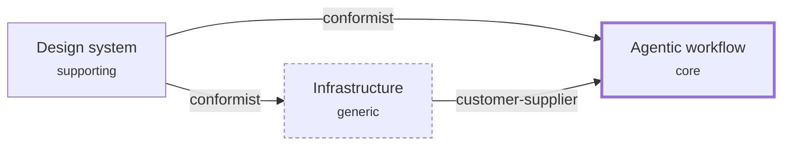

# Context map

Agentheim has three bounded contexts. One is the product (the agentic workflow itself). The
other two exist to serve it: the visual language of the dashboard, and the dashboard's
runtime. The map is small on purpose. A new context appears only when a concern is genuinely
independent of the workflow, never pre-emptively.

## Contexts

### Agentic workflow
- **Purpose:** running a domain-driven, human-in-the-loop agentic workflow on top of Claude
  Code. It turns an idea into a vision, a vision into a modeled backlog, and a backlog into
  verified, committed code. It also owns the read-only dashboard's meaning: what the board
  shows and what a task transition is.
- **Core language:** vision, bounded context, task (backlog / todo / doing / done), refine,
  promote, conductor, worker, verifier, worktree, ADR, protocol, README delta, live-tree hub.
- **Classification:** core. It is Agentheim's reason to exist; everything else serves it.
- **Key actors:** the builder; the skills (brainstorm, modeling, work, research, whats-next);
  the specialist agents (orchestrator, modelers, architect, worker, verifier).

### Design system
- **Purpose:** the single reviewed source of truth for Agentheim's look and feel. It holds the
  visual language, the component primitives (Markdown, Drawer, …) and the styleguide canvas
  that every UI-bearing feature must conform to.
- **Core language:** design tokens, primitive, styleguide, specimen, canvas, theme
  (dark / light).
- **Classification:** supporting. It is specific to Agentheim and needs care, but it serves the
  workflow's dashboard rather than being the product.
- **Key actors:** the builder, who reviews the styleguide before any UI is built on it; the
  dashboard, as its only consumer.

### Infrastructure
- **Purpose:** the standing home for globally true tech concerns. Today that is exactly one:
  the dashboard's web-server runtime and transport (launch, static serving, project discovery,
  the file watcher and `/api/events` stream, and the build pipeline that produces
  `dashboard/dist/`).
- **Core language:** launcher, runfile, port ladder, `/api/tree`, `/api/doc`, `tree-changed`
  frame, watcher, build stamp, derived artifact.
- **Classification:** generic. It is commodity plumbing (a local web server and a bundler)
  with nothing Agentheim-specific about how it works.
- **Key actors:** the dashboard server and launcher; the esbuild pipeline.

## Diagram

(Notation: `references/context-map-notation.md`. The prose below is the source of truth.)

## Relationships

- **Design system → Agentic workflow (conformist).** The dashboard consumes the styleguide's
  primitives exactly as they are, imported across the boundary and never forked (ADR-0003).
  Every UI task in the workflow depends on `design-system-001-styleguide`, and no frontend
  task is promoted ahead of the approved styleguide. The workflow adopts the design system's
  model; it does not negotiate it.
- **Infrastructure → Agentic workflow (customer-supplier).** Infrastructure supplies the
  transport the dashboard runs on: server, launch, static serving, discovery and the live
  `tree-changed` stream (ADR-0002, ADR-0006). The workflow is the downstream customer. What a
  change *means* stays with the workflow: the board is a projection rebuilt from disk
  (ADR-0001), the dashboard is read-only (ADR-0017), and the transport never interprets a frame
  as a task transition (ADR-0070). On those rules infrastructure obeys the workflow's
  definitions. The one-line test: *if the dashboard were strictly read-only, would this concern
  still exist?* If yes, it's infrastructure; if no, it belongs to the workflow.
- **Design system → Infrastructure (conformist).** The build pipeline produces the committed
  `dashboard/dist/` from the design system's ES-module source (ADR-0003, ADR-0083). The bundle
  is a derived artifact, never a hand-maintained copy, so it cannot drift from the approved
  styleguide. Infrastructure serves those assets; it never changes them.
